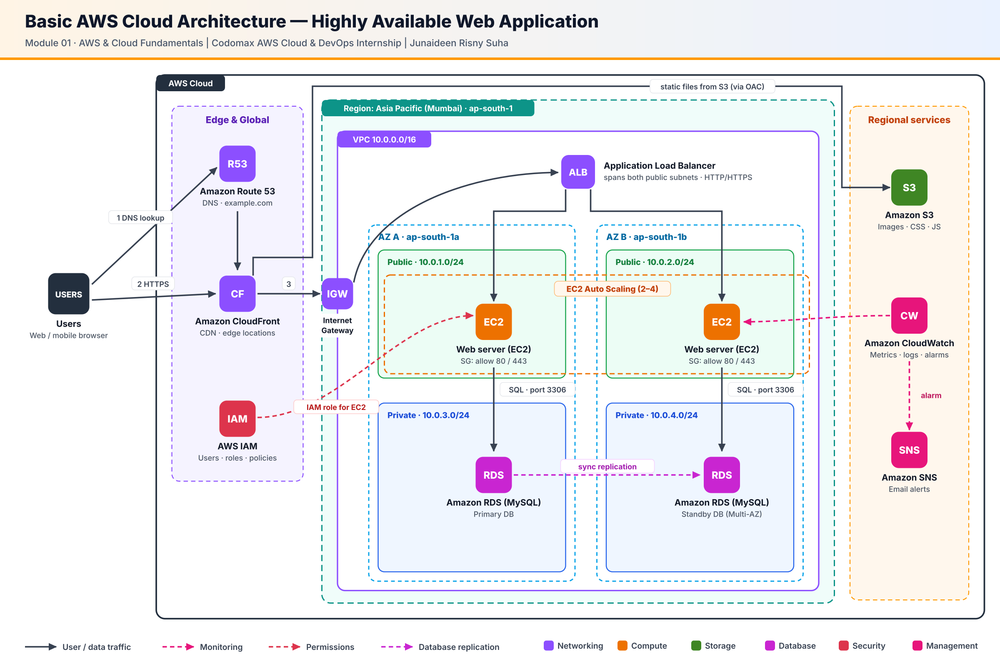

# Module 01 — AWS & Cloud Fundamentals

📄 **Learning notes:** [Google Doc](https://docs.google.com/document/d/1ZcGfD2Hk_ZVsUfifoBd54L2aVPhC8uO--ODsehYmZkQ/edit?usp=sharing)

Topics: cloud computing (NIST characteristics), IaaS / PaaS / SaaS, public / private / hybrid cloud, AWS Regions, Availability Zones and edge locations, the AWS Management Console, and the main AWS service families.

## Reference architecture — highly available web application

Route 53 → CloudFront (static files from S3 via OAC) → Internet Gateway → Application Load Balancer → EC2 Auto Scaling group across two AZs → RDS MySQL Multi-AZ in private subnets. IAM role for EC2, CloudWatch alarms → SNS.
