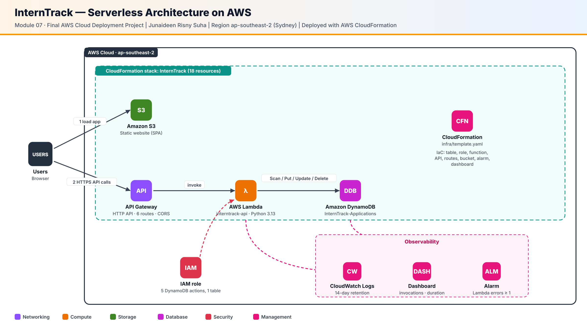

# Module 07 — Final AWS Cloud Deployment Project · **InternTrack**

A serverless internship-application tracker: add applications, move them from *Wishlist* → *Applied* → *Assessment* → *Interview* → *Offer*, and see interview/offer rates.

## AWS services (6)
| Service | Role |
|---|---|
| Amazon S3 | Static website hosting for the single-page app |
| Amazon API Gateway (HTTP API) | 6 routes, CORS, throttling 10 req/s (burst 20) |
| AWS Lambda | Python 3.13 CRUD + statistics, input validation |
| Amazon DynamoDB | `InternTrack-Applications` table (5 RCU / 5 WCU, free-tier sized) |
| Amazon CloudWatch | `InternTrack` dashboard, 14-day log retention, `InternTrack-Lambda-Errors` alarm |
| AWS IAM | Lambda role limited to Scan/Get/Put/Update/Delete on that one table |

## API
`GET /applications` · `POST /applications` · `PATCH /applications/{id}` · `DELETE /applications/{id}` · `GET /stats` · `GET /health`

## Deploy
Everything is in [`infra/template.yaml`](infra/template.yaml) (18 resources). `deploy.sh` zips the Lambda code to S3, runs `aws cloudformation deploy`, uploads the frontend with the API URL, and smoke-tests `/health`. `cleanup.sh` deletes the stack.
